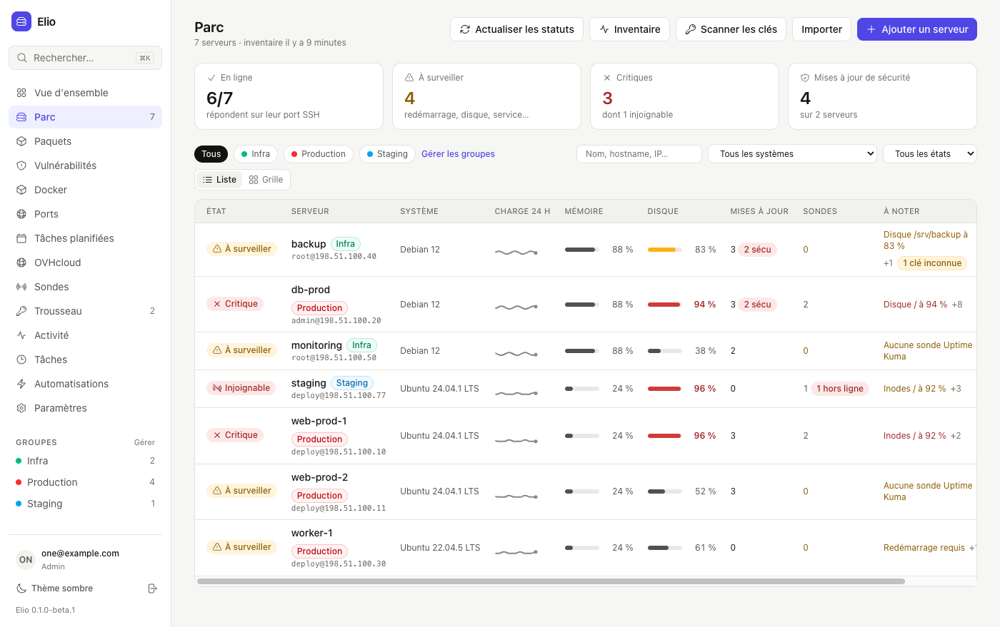
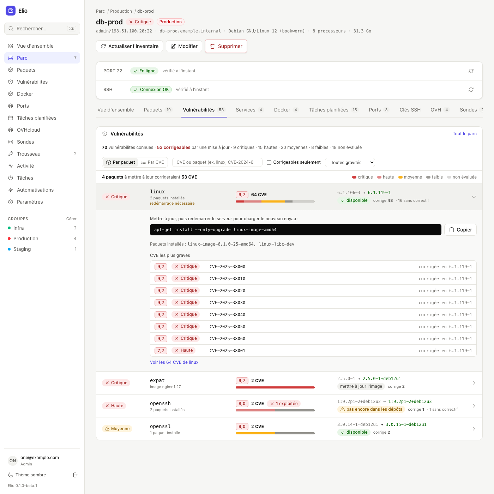
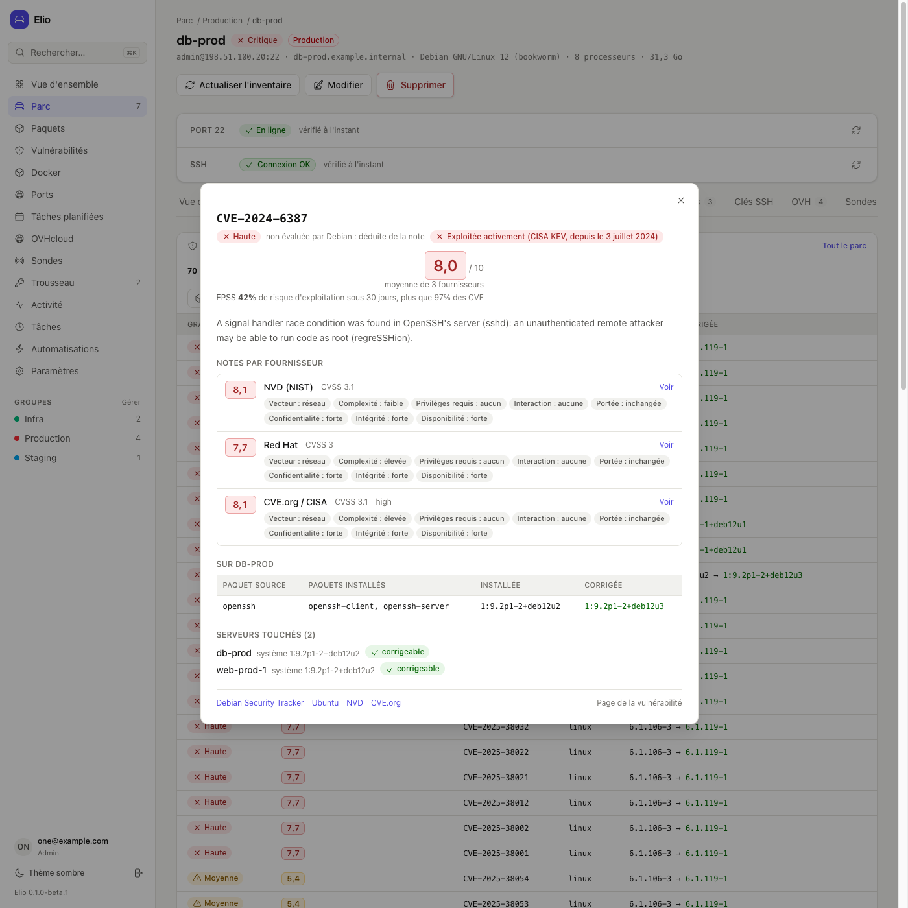
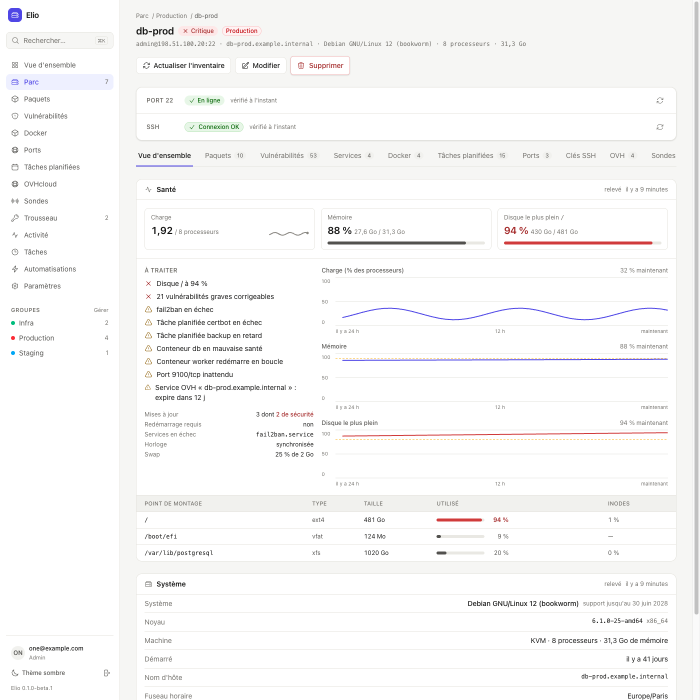
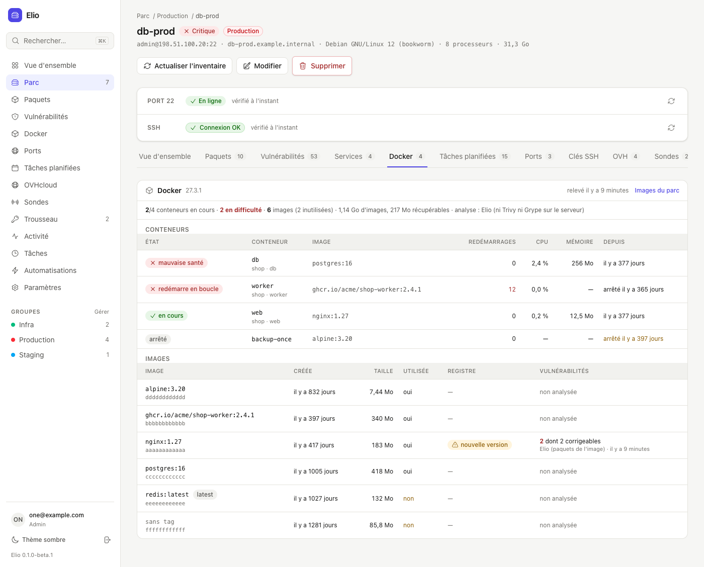
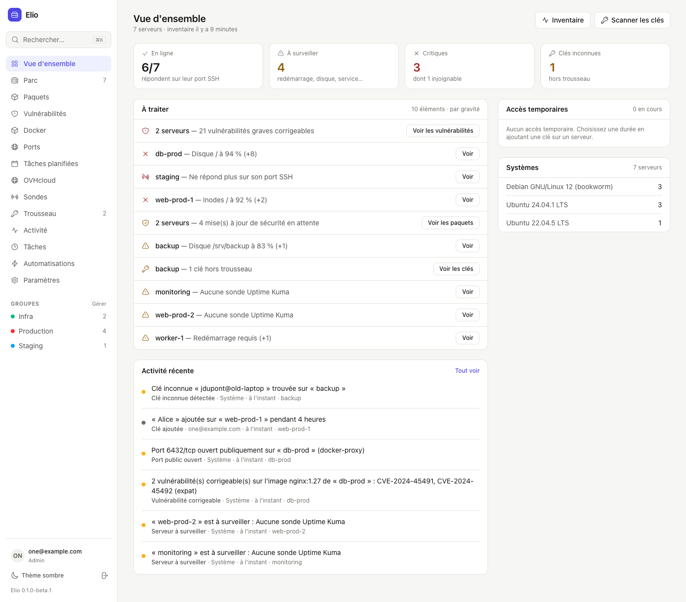
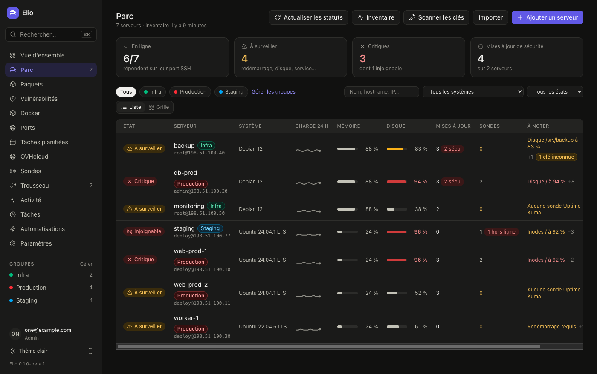
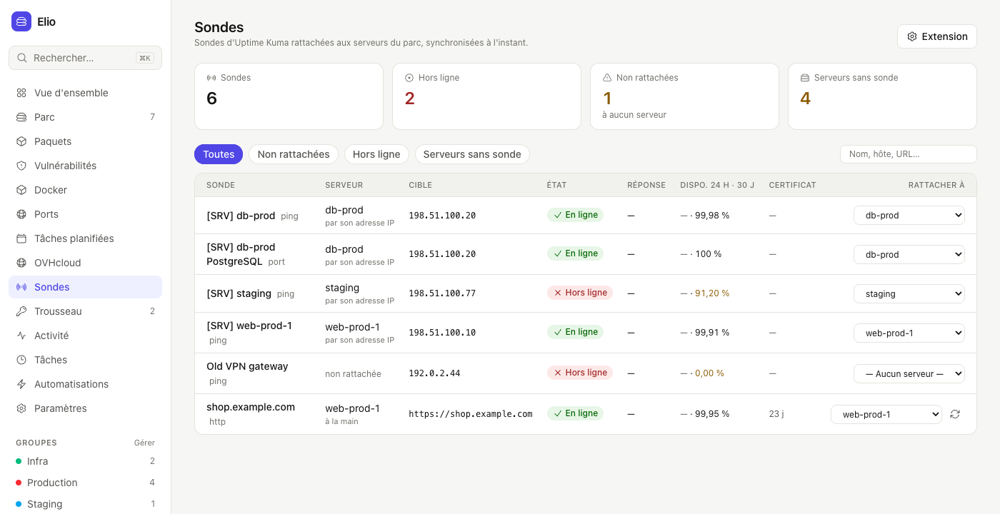
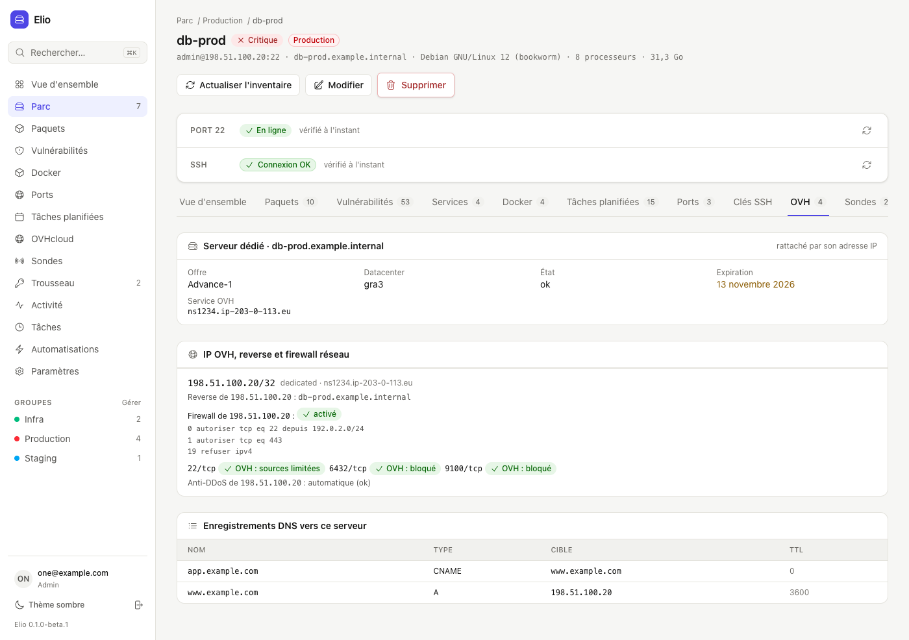

<p align="center">
  <picture>
    <source media="(prefers-color-scheme: dark)" srcset="docs/brand/logo-dark.svg">
    
  </picture>
</p>

<p align="center">
  <strong>Le gestionnaire auto-hébergé de votre parc de serveurs Linux.</strong><br>
  Santé, inventaire, vulnérabilités, Docker et clés SSH — sans agent, en lecture seule, par SSH.
</p>

<p align="center">
  <a href="https://github.com/elio-fleet/elio/actions/workflows/ci.yml"></a>
  <a href="https://github.com/elio-fleet/elio/releases"></a>
  <a href="LICENSE"></a>
  <a href="https://github.com/elio-fleet/elio/pkgs/container/elio"></a>
</p>

<p align="center">
  <a href="https://elio-fleet.github.io/elio/fr/">Site</a> ·
  <a href="#démarrage-rapide">Démarrage rapide</a> ·
  <a href="#fonctionnalités">Fonctionnalités</a> ·
  <a href="#extensions">Extensions</a> ·
  <a href="#sécurité">Sécurité</a> ·
  <a href="README.md">English</a>
</p>



Elio suit un parc de serveurs Debian et Ubuntu depuis un seul endroit : lesquels vont bien, ce qui tourne dessus, quels paquets sont vulnérables et comment les corriger, qui a une clé SSH dessus. Rien à installer sur les serveurs : Elio s'y connecte avec sa propre clé SSH et lance une courte liste de **commandes en lecture seule**, toutes écrites dans un seul fichier à relire — [`config/ssh_commands.yml`](config/ssh_commands.yml).

> **Bêta.** Elio est jeune (`v0.1.0-beta.1`). Il tourne sur de vrais serveurs, mais attendez-vous à quelques aspérités, et lisez les [limites connues](#limites-connues).

## Fonctionnalités

| | |
|---|---|
| **Santé** | Charge, mémoire, swap, disques et inodes, redémarrage requis, services en échec, horloge, mises à jour en attente — avec vos seuils et 30 jours d'historique. |
| **Inventaire** | Système et date de fin de support, adresses réseau (WireGuard compris), paquets (dpkg, snap), services systemd, **Docker** (conteneurs, images, projets Compose), **tâches planifiées** (cron, timers systemd), ports en écoute et firewall (ufw, nftables, iptables), avec des règles ufw suggérées à copier. |
| **Vulnérabilités** | Les CVE de chaque paquet, d'après le Debian Security Tracker et les données OSV d'Ubuntu, rapprochées de l'inventaire — aucune commande de plus sur les serveurs. Regroupées **par paquet, avec la mise à jour à faire** (`apt-get install --only-upgrade linux-image-amd64`, puis redémarrage). Notes de NVD, Red Hat et CVE.org (ou de vos propres fournisseurs), exploitation d'après EPSS et le catalogue CISA KEV. |
| **Docker** | Conteneurs en mauvaise santé ou qui redémarrent en boucle, images par serveur, **nouvelles versions publiées sur les registres** (Docker Hub, GHCR, Quay, registres privés), vulnérabilités des images (Trivy ou Grype s'ils sont installés, sinon le rapprochement d'Elio). |
| **Clés SSH** | Un trousseau commun (personnes et machines), des clés ajoutées ou retirées d'un serveur en un clic, des **accès temporaires** qui expirent tout seuls, les clés inconnues signalées, la rotation de la clé d'Elio sans coupure. |
| **Alertes** | Ce qui demande votre attention, par gravité, sur la vue d'ensemble ; journal d'activité ; notifications Slack, Discord, email ou webhook signé ; résumé quotidien. |
| **Automatisations** | Chaque collecte tourne à la fréquence voulue, sur tout le parc ou par groupe, suivie en direct dans la page *Tâches*. |
| **Extensions** | **Uptime Kuma** (sondes rattachées à chaque serveur) et **OVHcloud** (IP, firewall réseau, enregistrements DNS, services), en lecture seule. |
| **Équipe** | Rôles (admin, opérateur, lecture), invitations, double authentification obligatoire, recherche ⌘K partout, thèmes clair et sombre. |

| | |
|:---:|:---:|
|  |  |
| **Vulnérabilités par paquet**, avec la mise à jour à faire | **Une CVE en détail** : notes par fournisseur, vecteur CVSS en clair |
|  |  |
| **Un serveur** : santé, courbes sur 24 h, système | **Docker** : conteneurs, images, mises à jour, CVE |
|  |  |
| **Ce qui est à traiter**, le plus grave d'abord | **Thème sombre** |
|  |  |
| **Uptime Kuma** : les sondes rattachées à chaque serveur | **OVHcloud** : service, IP, firewall réseau port par port, DNS |

## Démarrage rapide

Avec Docker :

```sh
mkdir elio && cd elio
curl -fsSLO https://raw.githubusercontent.com/elio-fleet/elio/main/docker-compose.yml
docker run --rm ghcr.io/elio-fleet/elio:beta bin/elio-keys > .env    # les secrets de votre installation
echo "ELIO_DATABASE_PASSWORD=$(openssl rand -hex 24)" >> .env
docker compose up -d
```

Ouvrez <http://localhost:8080> et créez le premier compte : c'est l'administrateur. Puis, dans *Paramètres → Général*, générez la clé SSH d'Elio, ajoutez-la au `~/.ssh/authorized_keys` d'un serveur, et ajoutez le serveur.

**Gardez `.env` en lieu sûr** : sans ses clés, les données chiffrées (clé SSH d'Elio, clés d'API, webhooks) ne peuvent plus être relues.

## Installation en production

Elio est une application Rails avec PostgreSQL. Placez-la derrière un reverse proxy en HTTPS (Caddy, Traefik, nginx).

- **Docker Compose** : le [`docker-compose.yml`](docker-compose.yml) ci-dessus. Derrière votre proxy HTTPS, définissez `ELIO_HOST` (votre domaine) et retirez `ELIO_FORCE_SSL: "false"`.
- **Kamal** : [`config/deploy.yml`](config/deploy.yml) est prêt (HTTPS avec Let's Encrypt) ; mettez les secrets dans `.kamal/secrets` puis `bin/kamal setup`.
- **Mises à jour** : récupérez la nouvelle image (`docker compose pull && docker compose up -d`) ; les migrations se lancent au démarrage.
- **Sauvegardes** : les bases PostgreSQL et le volume `storage` (empreintes connues des serveurs).

### Configuration

| Variable | |
|---|---|
| `SECRET_KEY_BASE`, `ACTIVE_RECORD_ENCRYPTION_PRIMARY_KEY`, `ACTIVE_RECORD_ENCRYPTION_DETERMINISTIC_KEY`, `ACTIVE_RECORD_ENCRYPTION_KEY_DERIVATION_SALT` | Secrets de l'installation, affichés par `bin/elio-keys`. **Obligatoires.** (Une installation qui les garde dans les credentials Rails définit `RAILS_MASTER_KEY` à la place.) |
| `ELIO_DATABASE_PASSWORD`, `PGHOST` | Mot de passe PostgreSQL de l'utilisateur `elio`, et hôte. Elio utilise quatre bases : `elio_production`, `_cache`, `_queue`, `_cable`. |
| `ELIO_HOST` | Le domaine d'Elio : liens des emails, et seul nom d'hôte auquel il répond. |
| `ELIO_SETUP_TOKEN` | S'il est défini, demandé à la création du premier compte (utile si Elio est joignable avant que vous le configuriez). |
| `ELIO_FORCE_SSL` | `false` seulement pour essayer Elio en HTTP simple. Sinon, HTTPS est forcé. |
| `SMTP_ADDRESS`, `SMTP_PORT`, `SMTP_USERNAME`, `SMTP_PASSWORD`, `SMTP_AUTHENTICATION`, `ELIO_MAIL_FROM` | Emails : invitations, mot de passe oublié, notifications. Sans `SMTP_ADDRESS`, les liens d'invitation sont à copier. |
| `ELIO_PARALLEL_LIMIT` | Serveurs collectés en même temps (4). |
| `ELIO_ACTIVITY_RETENTION_DAYS` | Durée de conservation du journal d'activité (365, `0` = tout garder). |
| `ELIO_DEBIAN_TRACKER_URL`, `ELIO_UBUNTU_OSV_URL`, `ELIO_NVD_FEED_URL`, `ELIO_EPSS_URL`, `ELIO_KEV_URL` | Miroirs des bases de vulnérabilités, pour un réseau fermé (elles peuvent aussi être importées à la main). |

Tout le reste — seuils, notifications, automatisations, fournisseurs de notes, registres Docker, [extensions](#extensions) — se règle dans l'interface, par un administrateur. Les secrets qui y sont saisis (clés d'API, jetons, webhooks) sont chiffrés en base.

### Préparer les serveurs

1. Dans *Paramètres → Général*, générez la clé SSH d'Elio (Ed25519, gardée chiffrée).
2. Ajoutez sa clé publique au `~/.ssh/authorized_keys` du compte qu'Elio utilisera (la page donne la commande).
3. Ajoutez le serveur (ou importez-en plusieurs depuis un CSV ou votre `~/.ssh/config`), puis lancez un inventaire.

Elio lit tout ce qu'un compte sans privilège peut lire. Certains détails demandent root — le processus derrière chaque port, le firewall, Docker, les crontabs des utilisateurs : connectez Elio en root, ou donnez au compte un `sudo` sans mot de passe. Sans cela, ces collectes sont marquées *partielles*.

Pris en charge : **Debian et Ubuntu** (les autres systèmes : santé et système seulement), Docker, snap.

## Ce qu'Elio exécute sur vos serveurs

**Toutes les commandes sont dans [`config/ssh_commands.yml`](config/ssh_commands.yml)**, rangées par rôle puis par distribution. C'est le seul endroit où elles sont écrites : l'application les lit de là, et un test échoue si une commande est envoyée d'ailleurs. Les valeurs insérées sont toujours échappées.

| Pour | Commandes (lecture seule) |
|---|---|
| Système, réseau | `/etc/os-release`, `uname`, `hostname`, `systemd-detect-virt`, `/proc`, `timedatectl`, `ip -j addr`, `ip -j link` |
| Santé | `/proc/loadavg`, `/proc/meminfo`, `df`, `/var/run/reboot-required`, `systemctl --failed`, `apt-get -s dist-upgrade` (simulation) |
| Paquets | `dpkg-query -W`, `apt list --upgradable`, `snap list` |
| Services, tâches planifiées | `systemctl list-units`, `list-unit-files`, `show` des timers, `/etc/crontab`, `/etc/cron.d`, `/var/spool/cron` |
| Docker | `docker inspect` (état, santé, redémarrages — **jamais les variables d'environnement**), `docker stats`, `docker image inspect`, `docker system df`, `trivy` / `grype` s'ils sont installés, `docker cp` de `os-release` et de l'état dpkg |
| Ports | `ss -tulpn`, `/proc/<pid>/cgroup`, `ufw status verbose`, `nft list ruleset`, `iptables -S INPUT` |
| Clés SSH | lecture de `~/.ssh/authorized_keys` ; **écriture seulement** quand vous ajoutez ou retirez une clé |

Elio **ne modifie jamais le firewall** et n'installe rien : les règles ufw suggérées et les commandes de mise à jour sont à relire et à lancer vous-même.

## Extensions

Elio peut lire ce que savent vos autres outils et l'afficher à côté de chaque serveur. Activez-les dans *Paramètres → Extensions* (administrateurs). Elles **ne font que lire** : Elio ne crée, ne modifie et ne supprime jamais rien sur ces services, et une extension désactivée ne laisse aucune trace dans l'interface. Chaque alerte qu'elles lèvent est au choix, avec son seuil.

### Uptime Kuma

- **Réglage** : l'adresse de votre instance et une clé d'API (*Uptime Kuma → Paramètres → Clés API*). *Tester la connexion* les vérifie avant d'enregistrer.
- Elio lit la page `/metrics` toutes les 15 minutes (Uptime Kuma 1.x et 2.x) et **rattache chaque sonde à son serveur** : par l'IP surveillée (adresses WireGuard comprises), par le nom d'hôte (avec résolution DNS en option), ou par le nom du serveur dans celui de la sonde (`[SRV] web-prod-1`). Un rattachement se corrige à la main et reste gardé.
- Un onglet **Sondes** sur chaque serveur (état, temps de réponse, disponibilité sur 24 h et 30 jours, certificat) et une page **Sondes** : sondes rattachées à aucun serveur, serveurs sans sonde.
- Alertes au choix : serveur sans sonde (avec des groupes à ignorer), sonde hors ligne ou de retour, certificat bientôt expiré, disponibilité sous un seuil, sonde en maintenance depuis trop longtemps.

### OVHcloud

- **Réglage** : le point d'accès de l'API (EU, CA, US), une Application Key, un Application Secret et une Consumer Key **limitée aux requêtes GET**. *Droits à donner à la clé API* liste les droits exacts pour les produits cochés et ouvre la page de création de jeton d'OVH déjà remplie. *Tester la connexion* signale les droits manquants, et **prévient si la clé permet d'écrire** — refaites-en une dans ce cas.
- Chaque produit est une case à cocher : IP et reverse DNS, firewall réseau, anti-DDoS, zones DNS (toutes ou certaines), serveurs dédiés, VPS, instances Public Cloud (tous les projets ou certains).
- Un onglet **OVH** sur chaque serveur : le service OVH (offre, datacenter, expiration), ses IP et reverse, les règles du firewall réseau et **si elles laissent passer chaque port public**, l'anti-DDoS, les enregistrements DNS qui pointent vers lui. Une page **OVHcloud** : services, IP, enregistrements DNS, ressources rattachées à aucun serveur.
- Alertes au choix : service bientôt expiré (renouvellement automatique pris en compte), firewall réseau désactivé, reverse DNS qui ne correspond pas, serveur sans enregistrement DNS, enregistrement DNS vers une IP hors du parc, service OVH non suivi par Elio.

Le client OVH d'Elio ne connaît que la méthode GET : il ne peut pas écrire, quels que soient les droits de la clé.

## Sécurité

- La clé SSH d'Elio, les clés d'API, les webhooks et les secrets 2FA sont **chiffrés en base** et jamais renvoyés au navigateur.
- Double authentification (TOTP et codes de secours), obligatoire par défaut pour les administrateurs et les opérateurs ; rôles ; invitations seulement (pas d'inscription publique) ; connexion limitée en débit et verrouillage ; Content Security Policy stricte.
- L'empreinte de chaque serveur est mémorisée à la première connexion ; un changement bloque la connexion jusqu'à ce qu'un administrateur l'accepte.
- **Connexions sortantes** d'Elio : les bases de vulnérabilités et fournisseurs de notes (Debian, OSV, NVD, Red Hat, CVE.org, FIRST, CISA — seulement les versions et CVE de votre parc), les registres Docker (requêtes `HEAD` sur les manifestes), et les extensions que vous activez (votre instance Uptime Kuma, l'API OVH — en lecture seule, voir [Extensions](#extensions)). Rien d'autre, aucune télémétrie. En réseau fermé, les bases peuvent être importées à la main.
- Vous avez trouvé une faille ? Signalez-la en privé : voir [SECURITY.md](SECURITY.md).

## Limites connues

- Inventaire complet pour **Debian et Ubuntu** seulement. Ubuntu n'a pas encore été essayé sur un vrai serveur.
- Les extensions Uptime Kuma et OVHcloud ont été construites sur des réponses d'API enregistrées, pas encore essayées sur un vrai compte.
- CVE des images Docker sans Trivy ni Grype : images Debian et Ubuntu seulement (pas Alpine).
- Debian note peu de ses CVE : les notes viennent des fournisseurs que vous activez (NVD, Red Hat, CVE.org par défaut).

## Développement

```sh
bin/setup                 # gems, base de données, puis l'app sur http://localhost:3000
bin/rails test            # tests
bin/ci                    # ce que lance la CI : style, audits de sécurité, tests, tests système
```

Ruby (voir `.ruby-version`), PostgreSQL, Chrome pour les tests système. Voir [CONTRIBUTING.md](CONTRIBUTING.md) (en anglais) pour les conventions et l'organisation du code.

Construit avec Ruby on Rails 8, Hotwire, Tailwind CSS, Solid Queue et [net-ssh](https://github.com/net-ssh/net-ssh).

## Licence

[AGPL-3.0](LICENSE). Vous pouvez utiliser, modifier et héberger Elio ; si vous le proposez en service à d'autres, partagez vos modifications.
