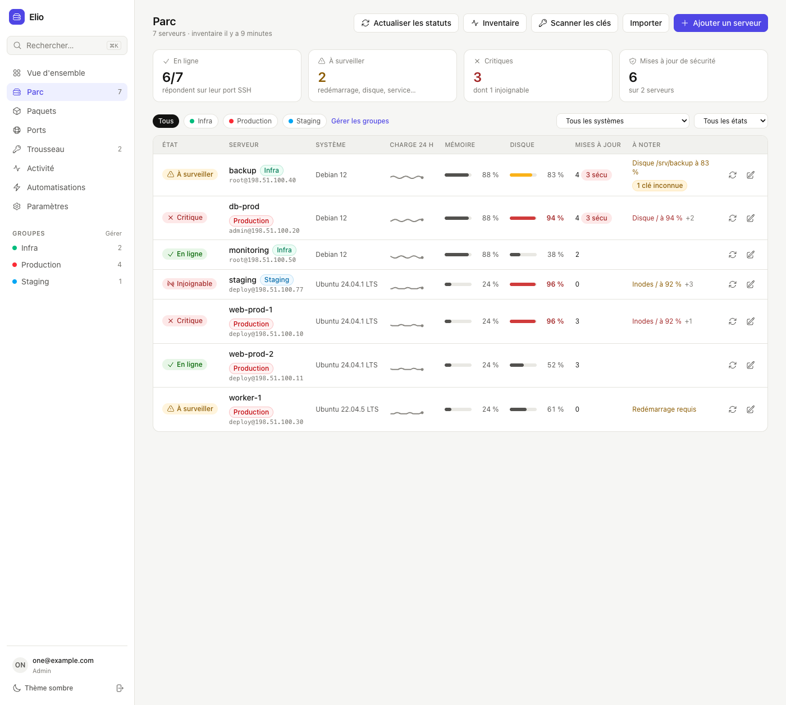
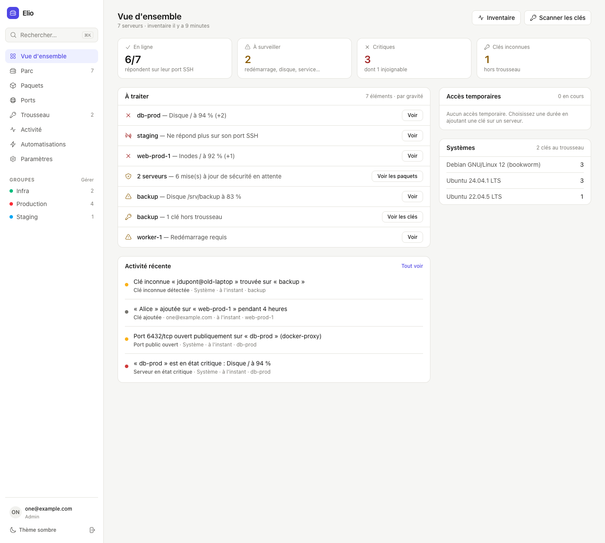
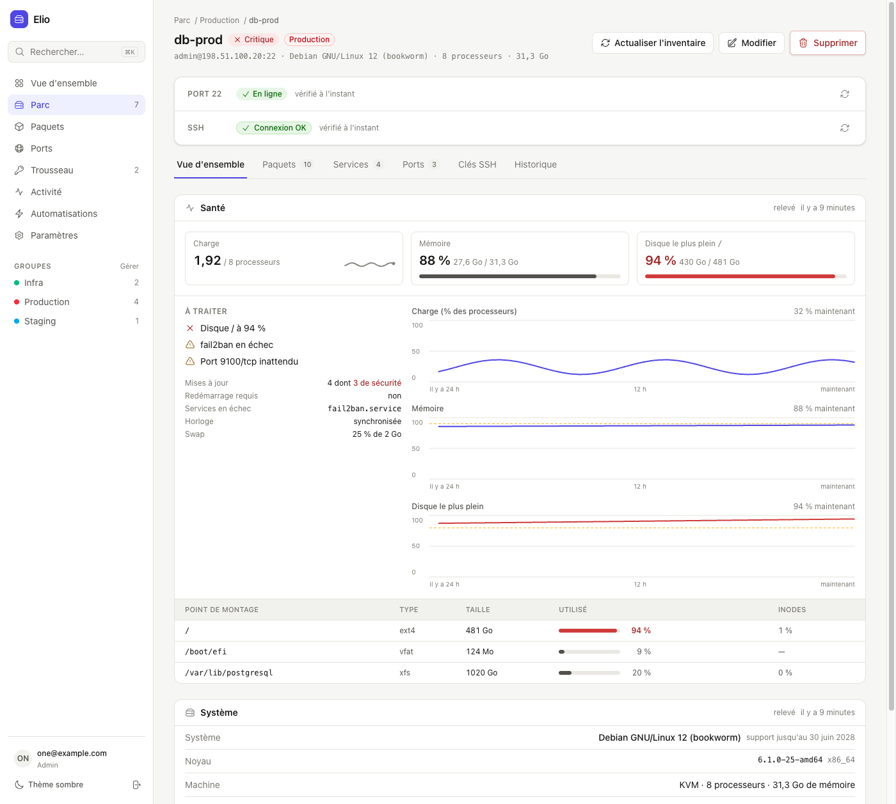
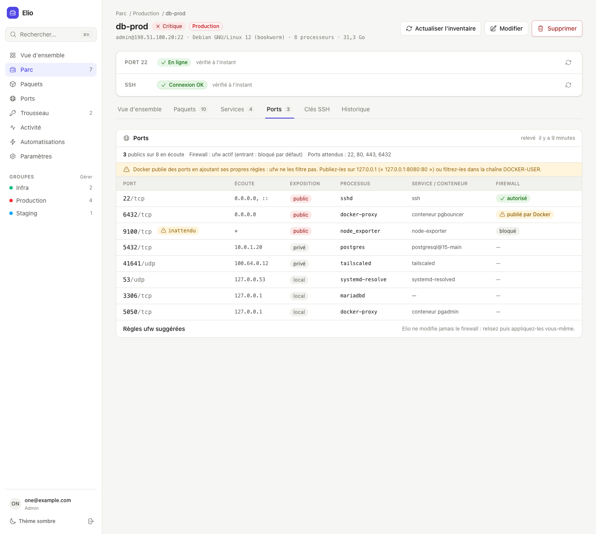
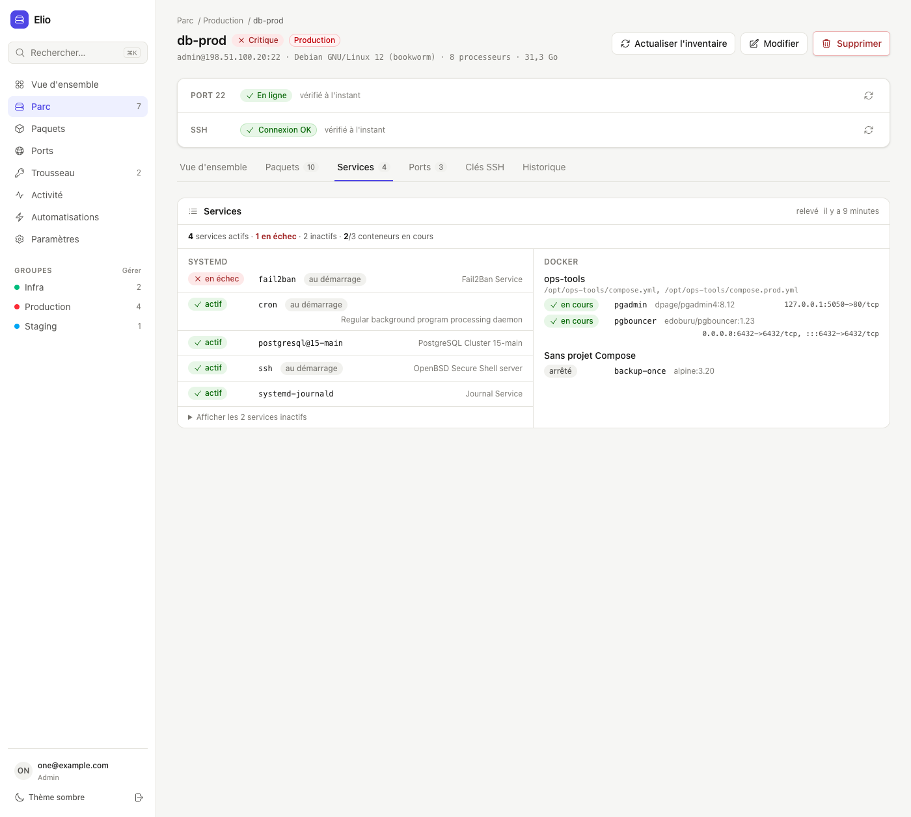
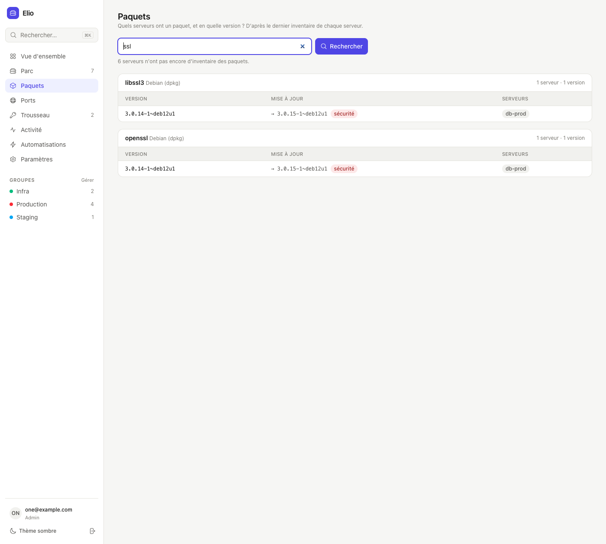
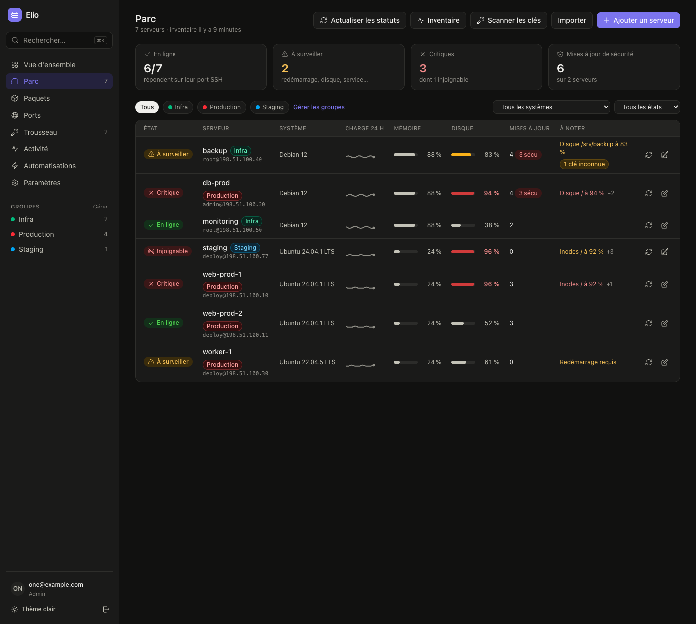

<div align="center">

# Elio

**Le gestionnaire de votre parc de serveurs Linux, sans agent.**

Santé, système, paquets, services, ports et firewall de chaque serveur, et les clés SSH de votre équipe, depuis une seule interface web. Elio se connecte à vos serveurs avec sa propre clé SSH et n'y exécute que des commandes de lecture (et l'ajout / le retrait de clés quand vous le demandez).




</div>

> Elio s'appelait auparavant **SSHM** (gestionnaire de clés SSH). Voir [Mise à jour depuis SSHM](#mise-à-jour-depuis-sshm).

## Sommaire

- [Fonctionnalités](#fonctionnalités)
- [Installation](#installation)
- [Configuration](#configuration)
- [Préparer les serveurs](#préparer-les-serveurs)
- [Ce qu'Elio exécute sur vos serveurs](#ce-quelio-exécute-sur-vos-serveurs)
- [Extensions (Uptime Kuma, OVHcloud)](#extensions-uptime-kuma-ovhcloud)
- [Sécurité et limites](#sécurité-et-limites)
- [Mise à jour depuis SSHM](#mise-à-jour-depuis-sshm)
- [Développement et tests](#développement-et-tests)

---

## Fonctionnalités

| | |
|---|---|
| **Vue d'ensemble** | Serveurs en ligne, à surveiller, critiques, clés inconnues, et une liste **« À traiter »** triée par gravité, avec un bouton pour agir sur chaque point. |
| **Parc** | Tous les serveurs : état de santé, système, courbe de charge sur 24 h, mémoire, disque, mises à jour (dont sécurité), ce qui mérite attention. Filtres par groupe, système et état. |
| **Santé** | Charge, mémoire, swap, disques (espace et inodes), redémarrage requis, services en échec, horloge, mises à jour en attente. 30 jours d'historique, seuils réglables. |
| **Système** | Distribution, noyau, machine (virtualisation, processeurs, mémoire), démarrage, avec la **date de fin de support** Debian / Ubuntu. |
| **Paquets** | Paquets Debian, snaps et images Docker de chaque serveur, mises à jour disponibles (sécurité en évidence). Recherche sur tout le parc : « quels serveurs ont openssl, et en quelle version ? » |
| **Services** | Services systemd et conteneurs Docker, regroupés par projet Docker Compose (avec le chemin des fichiers compose). |
| **Vulnérabilités (CVE)** | Les CVE qui touchent les paquets de chaque serveur, d'après le **Debian Security Tracker** et les avis **Ubuntu** (OSV), téléchargés chaque jour (ou importés à la main sur un réseau fermé) et rapprochés des paquets déjà inventoriés : aucune commande de plus sur les serveurs. Chaque CVE reçoit une **note** : la moyenne CVSS des fournisseurs choisis (NVD, Red Hat, CVE.org, ou un fournisseur à vous : API JSON ou page web), plus l'**EPSS** (probabilité d'exploitation) et le badge **« exploitée »** du catalogue CISA KEV ; la note donne la gravité des CVE que Debian n'évalue pas. Un clic ouvre le détail : notes par fournisseur, vecteur CVSS en clair, paquets, autres serveurs touchés. Alerte au choix à partir d'une gravité. |
| **Docker** | Conteneurs (en mauvaise santé, qui **redémarrent en boucle**, arrêtés depuis longtemps, CPU et mémoire), images (âge, taille, inutilisées, tags « latest »), **nouvelles versions publiées** sur les registres (Docker Hub, GHCR, Quay, registres privés), **vulnérabilités des images** (Trivy ou Grype s'ils sont sur le serveur, sinon Elio à partir des paquets de l'image). Page du parc : même image à des versions différentes selon les serveurs. Alertes au choix. |
| **Tâches planifiées** | Crontabs (système et utilisateurs), scripts `cron.daily`… et timers systemd de chaque serveur, en clair (« tous les jours à 3 h 00 »), avec le dernier passage des timers : **en échec** ou **en retard** signalés. Recherche sur tout le parc : « quels serveurs lancent backup.sh ? » |
| **Ports et firewall** | Ports en écoute avec le processus, le service ou le conteneur derrière, exposition (public, privé, local), état du firewall (ufw, nftables, iptables), **règles ufw suggérées à copier**, ports inattendus par groupe. |
| **Trousseau** | Les clés SSH de l'équipe et des machines (CI, sauvegardes…), à ajouter ou retirer sur chaque serveur — depuis le trousseau ou en collant une nouvelle clé directement sur la fiche du serveur —, pour toujours ou pour une durée limitée. Les clés inconnues trouvées sur les serveurs sont signalées. |
| **Automatisations** | Suivi de la santé, inventaires (système, paquets, services, Docker et tâches planifiées, ports), bases de vulnérabilités, nouvelles versions des images Docker, vérification des serveurs et scan des clés, à la fréquence de votre choix, sur tout le parc ou par groupe. |
| **Réseau** | Toutes les adresses de chaque serveur (publiques, réseau local, **WireGuard** et autres VPN) et son hostname ; recherche d'un serveur par IP. |
| **Extensions** | **Uptime Kuma** (les sondes rattachées à chaque serveur, serveurs sans sonde, sondes hors ligne, certificats) et **OVHcloud** (service, IP et reverse, firewall réseau, anti-DDoS, enregistrements DNS vers chaque serveur), en lecture seule, chaque alerte au choix. |
| **Tâches** | Chaque inventaire, scan ou automatisation lancé en arrière-plan est suivi en direct : à venir, en cours, terminé, en échec, avec le résultat et l'erreur de chaque serveur. Les administrateurs ont aussi la vue technique de la file (Mission Control, `/jobs`). |
| **Activité et notifications** | Journal de tout ce qui se passe (ajouts de clés, serveurs qui tombent, ports qui s'ouvrent, services en échec…), envoyé sur **Slack, Discord, un webhook signé ou par email**, avec un résumé chaque matin. |
| **Accès à Elio** | Rôles (admin, opérateur, lecture), invitations, double authentification (TOTP + codes de secours), verrouillage après échecs, expiration de session. |
| **Interface** | Mode clair et sombre, utilisable sur téléphone, recherche rapide (⌘K : pages, serveurs et leurs onglets, clés, paquets, ports), en français. |

| | |
|---|---|
|  |  |
|  |  |
|  |  |

---

## Installation

| | Version | Remarque |
|---|---|---|
| Ruby | 3.4.2 | voir `.ruby-version` |
| PostgreSQL | 14+ | 4 bases en production (application, cache, files d'attente, websockets) |
| **Serveurs gérés** | Linux avec OpenSSH | inventaire complet sur **Debian / Ubuntu** (dpkg, apt, systemd) ; OpenSSH 8.2+ pour les accès temporaires |

### En local

```bash
git clone git@github.com:YanisDahmane/sshm.git elio
cd elio

bundle install
bin/rails db:prepare   # crée les bases et lance les migrations
bin/dev                # serveur Rails, Tailwind et jobs (Solid Queue)
```

Ouvrez **http://localhost:3000** : au premier lancement, Elio vous demande de créer le compte administrateur.

### En production (Kamal)

Le projet est prêt pour [Kamal](https://kamal-deploy.org) (`config/deploy.yml`, service `elio`) : image Docker, proxy avec SSL, jobs Solid Queue intégrés à Puma.

1. Renseignez dans `config/deploy.yml` votre serveur, votre registry, votre domaine (`proxy.host`), `PGHOST` et les variables d'environnement ci-dessous.
2. Ajoutez les secrets dans `.kamal/secrets` : `RAILS_MASTER_KEY`, `ELIO_DATABASE_PASSWORD` (utilisateur PostgreSQL `elio`, bases `elio_production`, `elio_production_cache`, `elio_production_queue`, `elio_production_cable`), et si besoin `SMTP_PASSWORD`.
3. `bin/kamal setup` la première fois, puis `bin/kamal deploy`.

> [!IMPORTANT]
> Le volume `elio_storage` (monté sur `/rails/storage`) contient `storage/ssh/known_hosts`, les empreintes des serveurs mémorisées par Elio. Ne le supprimez pas.

---

## Configuration

### Variables d'environnement

| Variable | Rôle |
|---|---|
| `RAILS_MASTER_KEY` | Déchiffre `config/credentials.yml.enc` (clés de chiffrement de la base). |
| `ELIO_DATABASE_PASSWORD` | Mot de passe PostgreSQL de l'utilisateur `elio` (production). |
| `SMTP_ADDRESS`, `SMTP_PORT` (587), `SMTP_USERNAME`, `SMTP_PASSWORD`, `SMTP_AUTHENTICATION` (plain) | Envoi d'emails : mot de passe oublié, invitations, canaux de notification email. Sans `SMTP_ADDRESS`, rien n'est envoyé et le lien « Mot de passe oublié » n'apparaît pas. |
| `ELIO_HOST` | Adresse d'Elio utilisée dans les liens des emails (ex. `elio.acme.fr`). En production, Elio ne répond alors qu'à ce nom (protection contre les en-têtes Host forgés). |
| `ELIO_SETUP_TOKEN` | **Recommandé en production** : jeton demandé pour créer le premier compte administrateur (sans lui, la première personne qui atteint une installation neuve devient admin). |
| `ELIO_ACTIVITY_RETENTION_DAYS` | Durée de conservation du journal d'activité (365 jours par défaut, `0` = tout garder). |
| `ELIO_MAIL_FROM` | Expéditeur des emails (ex. `elio@acme.fr`). |
| `ELIO_NVD_FEED_URL`, `ELIO_EPSS_URL`, `ELIO_KEV_URL` | Adresses des fichiers NVD (`%{name}` = année ou `modified`), EPSS et CISA KEV, pour un miroir interne. |
| `ELIO_DEBIAN_TRACKER_URL`, `ELIO_UBUNTU_OSV_URL` | Adresses des bases de vulnérabilités (par défaut celles de Debian et d'OSV ; un miroir interne par exemple). |
| `ELIO_PARALLEL_LIMIT` | Nombre de serveurs traités en même temps par les inventaires et scans (4 par défaut). |

### Clés de chiffrement

La clé privée SSH d'Elio, les webhooks et les secrets 2FA sont chiffrés en base avec [Active Record Encryption](https://guides.rubyonrails.org/active_record_encryption.html). Pour votre propre instance :

```bash
rm config/credentials.yml.enc
bin/rails db:encryption:init      # affiche un bloc active_record_encryption: ...
bin/rails credentials:edit        # collez-y ce bloc
```

Gardez `config/master.key` (ou `RAILS_MASTER_KEY`) en lieu sûr : sans lui, les données chiffrées sont perdues.

### Premiers pas

1. **Paramètres → Général → Générer une clé SSH** : Elio crée sa paire de clés Ed25519 ; la clé privée ne quitte jamais la base.
2. **Parc → Ajouter un serveur** (ou **Importer** depuis un CSV ou votre `~/.ssh/config`).
3. Installez la clé publique d'Elio sur le serveur (la commande est proposée à l'écran), puis **Actualiser l'inventaire** ; la page **Tâches** montre son avancement.
4. **Trousseau → Ajouter une clé** pour chaque membre de l'équipe, puis ajoutez-les sur les serveurs.
5. **Paramètres → Notifications** pour recevoir les alertes, **Automatisations** pour planifier les inventaires (seul le suivi de la santé est activé par défaut).

---

## Préparer les serveurs

Sur chaque serveur, avec le compte qu'Elio utilisera :

```bash
mkdir -p ~/.ssh && chmod 700 ~/.ssh
echo 'ssh-ed25519 AAAA… elio' >> ~/.ssh/authorized_keys   # la clé publique affichée dans Paramètres
chmod 600 ~/.ssh/authorized_keys
```

**`sudo` sans mot de passe est facultatif mais recommandé** si Elio ne se connecte pas en `root`. Sans lui, l'inventaire est **partiel** : processus des autres utilisateurs inconnus derrière les ports, firewall illisible, conteneurs Docker illisibles (sauf si le compte est dans le groupe `docker`).

```bash
# /etc/sudoers.d/elio — à éditer avec : visudo -f /etc/sudoers.d/elio
deploy ALL=(ALL) NOPASSWD: ALL
```

Elio vérifie l'accès avec `sudo -n true` à chaque inventaire et l'indique sur la fiche du serveur.

---

## Ce qu'Elio exécute sur vos serveurs

Tout passe par SSH, avec la clé d'Elio uniquement (jamais votre agent ni vos clés). Chaque commande a un délai maximum (60 s), et un serveur qui ne répond plus ne bloque pas les autres.

**Toutes les commandes sont dans [`config/ssh_commands.yml`](config/ssh_commands.yml)**, rangées par rôle puis par distribution : c'est le seul endroit où elles sont écrites, l'application les lit de là (aucune commande n'est construite ailleurs dans le code). Les valeurs insérées (clé, ligne…) sont toujours échappées. Résumé :

| Pour | Commandes (lecture seule) |
|---|---|
| Système | `cat /etc/os-release`, `uname -srm`, `hostname -f`, `systemd-detect-virt`, `/proc/uptime`, `nproc`, `/proc/meminfo`, `timedatectl` |
| Réseau | `ip -j addr`, `ip -d -j link` |
| Santé | `/proc/loadavg`, `/proc/meminfo`, `df -P -T` (espace et inodes), `/var/run/reboot-required`, `systemctl --failed`, `apt-get -s dist-upgrade` (simulation), `timedatectl` |
| Paquets | `dpkg-query -W` (avec le paquet source, pour les CVE), `apt list --upgradable`, `snap list`, `docker image ls` |
| Services | `systemctl list-units`, `systemctl list-unit-files`, `docker ps -a` |
| Docker | `docker version`, `docker inspect` des conteneurs (état, santé, redémarrages — **jamais leurs variables d'environnement**), `docker stats --no-stream`, `docker image inspect`, `docker system df` ; pour les vulnérabilités des images : `trivy image` ou `grype` s'ils sont installés, sinon `docker cp` (lecture) de `/etc/os-release` et `/var/lib/dpkg/status` d'un conteneur de l'image |
| Tâches planifiées | `cat /etc/crontab /etc/cron.d/*`, liste de `/etc/cron.{hourly,daily,weekly,monthly}`, crontabs de `/var/spool/cron` (root), `systemctl show` des timers |
| Ports | `ss -tulpn`, `/proc/<pid>/cgroup`, `ufw status verbose`, `nft list ruleset`, `iptables -S INPUT` |
| Clés SSH | lecture de `~/.ssh/authorized_keys` ; **écriture seulement** quand vous ajoutez ou retirez une clé |

Elio **ne modifie jamais le firewall** : les règles ufw sont des suggestions à relire et appliquer vous-même.

---

## Extensions (Uptime Kuma, OVHcloud)

**Paramètres → Extensions** (administrateurs). Une extension désactivée n'apparaît nulle part. Elio n'y fait que **lire** : il ne crée, ne modifie et ne supprime rien.

- **Uptime Kuma** : l'adresse de l'instance et une clé API (*Uptime Kuma → Paramètres → Clés API*). Elio lit la page `/metrics` toutes les 15 minutes et rattache chaque sonde à son serveur : par l'IP visée (y compris une IP WireGuard), par le nom d'hôte (avec résolution DNS en option) ou par le nom de la sonde (`[SRV] FR-UTILS-1`) ; un rattachement peut être corrigé à la main. Onglet **Sondes** sur chaque serveur, page **Sondes** (sondes non rattachées, serveurs sans sonde), alertes au choix.
- **OVHcloud** : Application Key, Application Secret et Consumer Key **limitée aux requêtes GET**. Le bouton *Droits à donner à la clé API* liste les droits nécessaires selon les ressources cochées et ouvre la page de création de clé d'OVH déjà remplie ; *Tester la connexion* signale les droits manquants et une clé qui permettrait d'écrire. Onglet **OVH** sur chaque serveur (service, IP, reverse, firewall réseau et son effet sur les ports publics, anti-DDoS, enregistrements DNS), page **OVHcloud** (services, IP, DNS ; ressources hors du parc).

Les rattachements utilisent toutes les adresses relevées par l'inventaire du système : lancez-le avant d'activer une extension.

---

## Sécurité et limites

- Double authentification (TOTP + codes de secours) obligatoire par défaut pour les administrateurs **et les opérateurs** (réglable) ; « se souvenir de moi » limité à 7 jours.
- Mots de passe de 12 caractères minimum ; connexion, mot de passe oublié, invitations et premier lancement limités en débit par adresse IP, en plus du verrouillage du compte après 10 échecs.
- Content Security Policy stricte (scripts d'Elio seulement, avec nonce), HTTPS forcé en production, secrets (clé SSH, webhooks, clés d'API, secret 2FA) chiffrés en base et masqués dans les journaux.
- Webhooks signés : `X-Elio-Signature: sha256=` HMAC SHA-256 de `"<X-Elio-Timestamp>.<corps>"` avec le secret du canal ; refusez les messages trop anciens.
- Dépendances vérifiées à chaque CI (`bundler-audit`, `importmap audit`, Brakeman).

- Pas d'inscription publique : premier compte au premier lancement, puis invitations. Double authentification obligatoire pour les administrateurs (réglable).
- Rôles : **lecture** (tout voir), **opérateur** (serveurs, clés, inventaires), **admin** (paramètres, utilisateurs, notifications, automatisations, rotation de la clé d'Elio).
- La clé d'Elio peut être **remplacée sans coupure** (rotation serveur par serveur) ou régénérée en urgence.
- Les empreintes des serveurs sont mémorisées à la première connexion ; un changement bloque la connexion jusqu'à ce qu'un admin l'accepte.
- Les accès temporaires utilisent l'option OpenSSH `expiry-time` **et** un job de suppression : la clé est refusée à l'heure prévue même si Elio est arrêté. Une session déjà ouverte n'est pas coupée.
- Accès sortants d'Elio : les bases de vulnérabilités (`security-tracker.debian.org`, `osv-vulnerabilities.storage.googleapis.com`, une fois par jour, seulement les versions présentes sur le parc), les fournisseurs de notes actifs (`nvd.nist.gov` et `services.nvd.nist.gov`, `access.redhat.com`, `cveawg.mitre.org`, `epss.empiricalsecurity.com`, `cisa.gov`, et vos fournisseurs personnalisés, chacun à son rythme, seulement pour les CVE du parc pas encore notées), les extensions activées et les registres Docker (requêtes `HEAD` sur les manifestes, toutes les 6 heures au plus par image ; identifiants des registres privés chiffrés, dans **Paramètres → Docker**). Sans accès Internet, importez les bases dans **Paramètres → Vulnérabilités**.
- Les vulnérabilités Debian suivent l'urgence donnée par Debian (basse, moyenne, haute) ; celles qu'il juge sans importance (« unimportant ») ou hors support (« end-of-life ») ne sont pas listées. Côté Ubuntu, la priorité d'Ubuntu, sans les éditions Pro / FIPS.
- L'inventaire complet vise **Debian et Ubuntu**. Sur d'autres distributions, Elio relève la santé et le système ; les paquets apparaissent « non disponibles ».

---

## Mise à jour depuis SSHM

- Les bases s'appellent désormais `elio_*` (et l'utilisateur PostgreSQL `elio`). Pour garder vos données en local : arrêtez `bin/dev`, supprimez les bases `elio_development*` éventuellement créées, puis `ALTER DATABASE sshm_development RENAME TO elio_development` (idem pour `_queue`) et `bin/rails db:migrate`.
- Kamal : le service s'appelle `elio` et le volume `elio_storage` ; copiez le contenu de l'ancien volume `sshm_storage` (`ssh/known_hosts`).
- Variable `SSHM_DATABASE_PASSWORD` → `ELIO_DATABASE_PASSWORD`.
- Les « profils » sont devenus le **trousseau** ; les règles d'accès, équipes, demandes d'accès et la gestion de comptes Unix multiples ont été retirées (Elio gère le compte de connexion de chaque serveur).

---

## Développement et tests

Organisation du code :

- `config/ssh_commands.yml` : **toutes** les commandes envoyées aux serveurs (lues par `Ssh::Commands`).
- `app/models`, `app/controllers`, `app/jobs` (et leurs tests) : un dossier par domaine — `fleet` (parc, serveurs, groupes), `access` (trousseau, clé d'Elio, accès temporaires), `accounts` (utilisateurs, invitations, 2FA), `activity_log` (journal, notifications), `operations` (automatisations, tâches), `extensions` (Uptime Kuma, OVHcloud), `core`. Ces dossiers ne sont pas des namespaces (`config/initializers/autoloading.rb`) : `Server` reste `Server`.
- `app/services` : la logique par namespace — `Ssh::` (connexion, commandes, empreintes), `Inventory::` (collecteurs), `Keys::` (fichiers authorized_keys), `Notifications::` (Slack, Discord, webhook, email), `Servers::` (ping, import), `Integrations::` (extensions).

```bash
bin/rails test          # tests unitaires et d'intégration
bin/rails test:system   # tests système (Chrome)
bin/ci                  # tout : style, sécurité, tests
```

Les collecteurs d'inventaire sont testés sur des sorties enregistrées (`test/fixtures/files/inventory/`). La page `/design` (hors production) montre les composants de l'interface ; les maquettes et règles de l'interface sont dans [`docs/design/`](docs/design/README.md).
