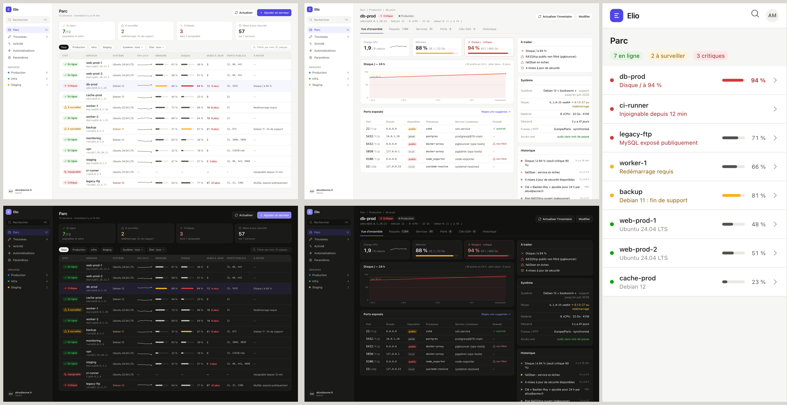

# Interface d'Elio — direction A « Console »

Choisie le 2026-10-31 parmi trois maquettes. Référence pour la refonte de l'interface (phase 3 du plan).



## Principes

- **Barre latérale** : logo, recherche ⌘K, navigation (Parc, Trousseau, Activité, Automatisations, Paramètres), groupes de serveurs avec leur nombre, compte en bas.
- **Parc** : 4 indicateurs (en ligne, à surveiller, critiques, mises à jour de sécurité), filtres sur une ligne (groupes en pastilles, système, état, recherche), tableau dense : état, serveur (nom + `user@hôte`), système, courbe CPU 24 h, jauges mémoire et disque, mises à jour (dont sécurité), ports publics, « à noter ».
- **Fiche serveur** : fil d'Ariane, en-tête (nom, état, groupe, résumé technique, actions), onglets avec compteurs (Vue d'ensemble, Paquets, Services, Ports, Clés SSH, Historique). Vue d'ensemble : 3 indicateurs (CPU, mémoire, disque), courbe 24 h avec seuil, ports exposés ; colonne de droite « À traiter », Système, Historique.
- Repris de la direction C : la liste « À traiter » et les règles ufw suggérées à copier dans l'onglet Ports.
- **Clair et sombre** : jetons de couleur en variables CSS (`input.css`), sombre sélectionné (pas une inversion automatique).

## Règles de visualisation

- Une couleur d'état (bon / attention / critique) n'est **jamais seule** : toujours une icône et un libellé.
- Jauges : piste d'un gris du même ton, remplissage neutre, orange au-dessus du seuil d'attention, rouge au-dessus du seuil critique.
- Courbes : trait de 2 px, discrètes (gris) dans les listes, colorées seulement dans la fiche ; seuils en pointillés.
- Texte des valeurs en encre normale, jamais dans la couleur de la série.

## Régénérer les maquettes

```sh
cd docs/design/mockups && python3 gen.py
RBENV_VERSION=3.4.2 bundle exec tailwindcss -i docs/design/mockups/input.css -o docs/design/mockups/out.css
```
(`gen.py` génère les 3 directions ; seules les pages A sont conservées ici. `out.css` n'est pas versionné : le générer avant d'ouvrir les pages.)
